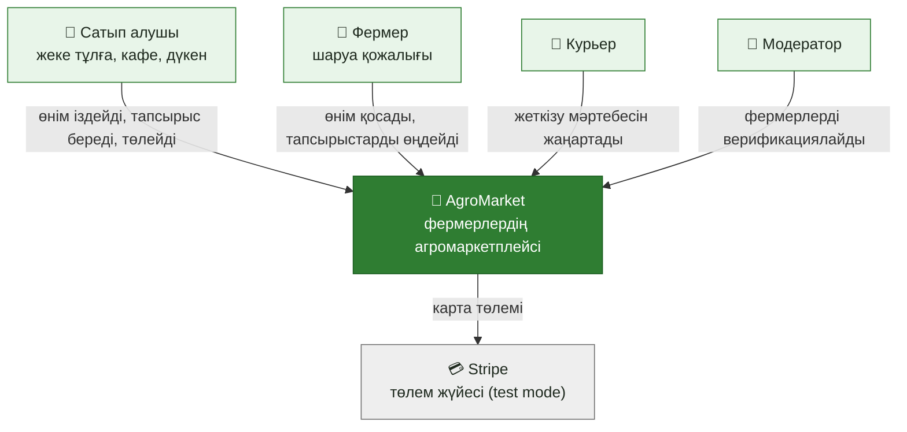
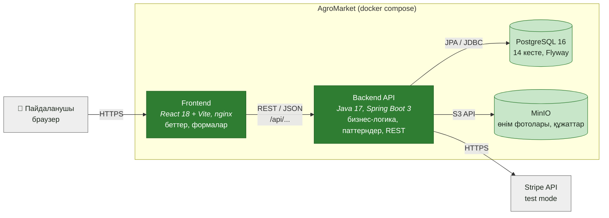
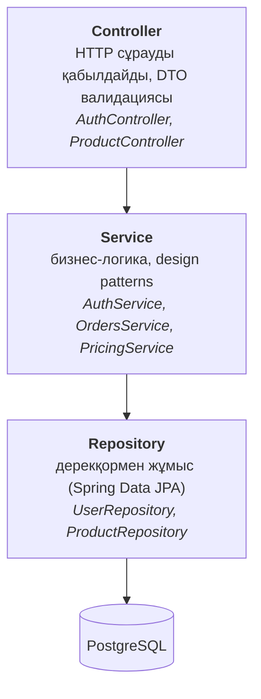
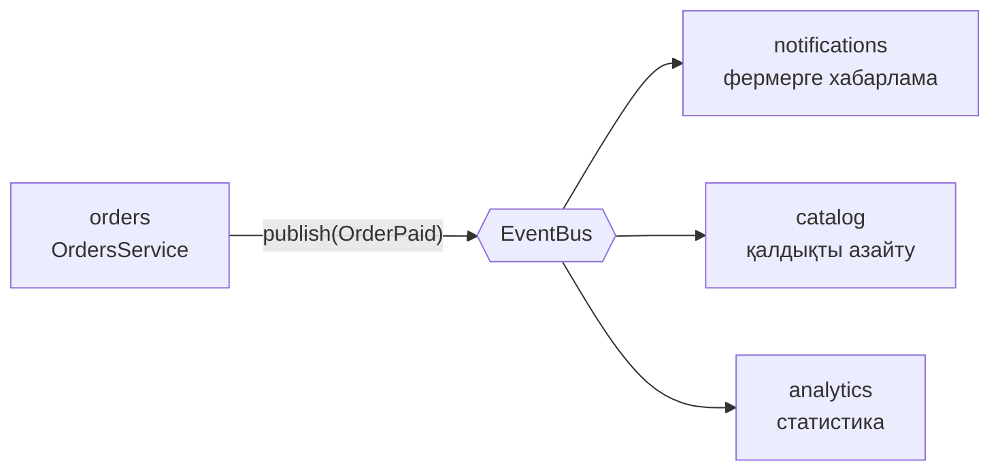
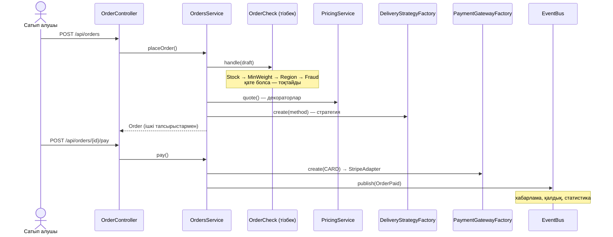
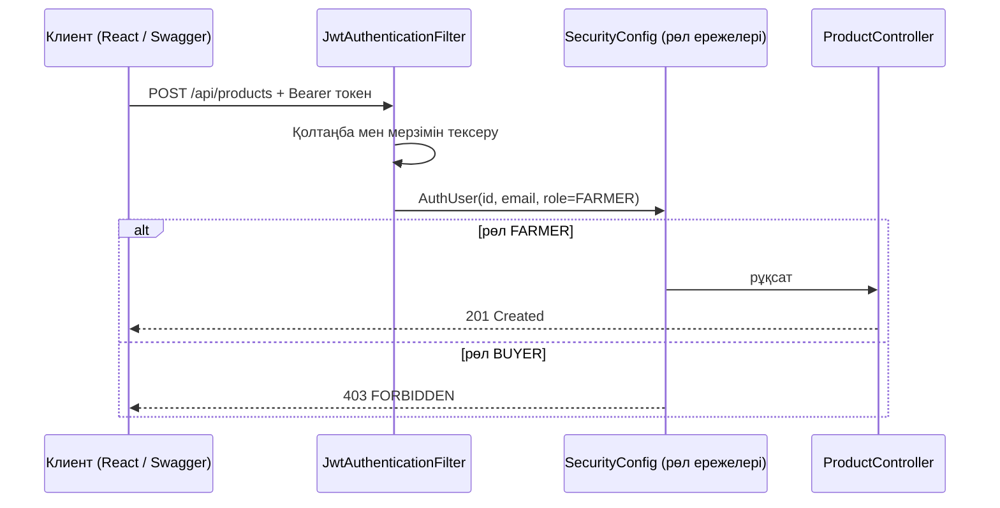

# Архитектура — AgroMarket

## 1. Жалпы шолу

AgroMarket — **модульді монолит** (modular monolith): бір Spring Boot қосымшасы, бір дерекқор, бірақ ішінде нақты бөлінген модульдер.

**Неге микросервис емес:**

| | Модульді монолит | Микросервистер |
|---|---|---|
| Іске қосу | Бір `docker compose up` | Әр сервис бөлек деплой |
| Модульдер байланысы | Java әдісі немесе оқиға (жылдам) | Желі арқылы HTTP/очередь (баяу, күрделі) |
| Транзакция | Бір дерекқорда — қарапайым | Таратылған транзакция — күрделі |
| 5 адамдық командаға, 3 аптаға | ✅ сәйкес | ❌ артық күрделілік |

Модульдер арасындағы шекара сақталады, сондықтан қажет болса кейін кез келген модульді (мысалы, `payments`) бөлек сервиске шығаруға болады.

## 2. C4 — 1-деңгей: Контекст

Жүйені кім қолданады және ол сыртқы қандай жүйелермен байланысады.



## 3. C4 — 2-деңгей: Контейнерлер

Жүйе қандай бөліктерден (контейнерлерден) тұрады. Әр контейнер Docker Compose-та бөлек іске қосылады.



| Контейнер | Технология | Порт | Жауапкершілігі |
|---|---|---|---|
| Frontend | React 18, Vite, nginx | 3000 (dev: 5173) | Беттер; `/api` сұрауларын backend-ке жібереді |
| Backend API | Java 17, Spring Boot 3.3 | 8080 | REST API, бизнес-логика, Swagger (`/swagger-ui.html`) |
| PostgreSQL | PostgreSQL 16 | 5432 | Негізгі дерекқор, миграциялар — Flyway |
| MinIO | S3-үйлесімді сақтау | 9000, 9001 | Өнім фотолары және фермер құжаттары |

## 4. Қабаттар (Layered Architecture)

Әр модуль ішінде бірдей 3 қабат бар. Сұрау тек жоғарыдан төмен қарай жүреді.



| Қабат | Не істейді | Не істемейді |
|---|---|---|
| **Controller** | HTTP сұрау/жауап, DTO, валидация (`@Valid`) | Бизнес-логика жазылмайды |
| **Service** | Барлық бизнес-ережелер мен паттерндер | HTTP мен SQL туралы білмейді |
| **Repository** | Дерекқорға сақтау және іздеу | Бизнес-шешім қабылдамайды |

**Ортақ компоненттер** (`common/`):
- `GlobalExceptionHandler` — кез келген қате бірыңғай JSON форматында: `{ code, message, status, path, timestamp, fieldErrors }`
- `EventBus` — модульдер арасындағы оқиғалар (Observer)
- `DomainException` — бизнес-қате, HTTP статус кодымен

## 5. Модульдер

| Модуль | Жауапкершілігі | User stories | Паттерн | Жауапты |
|---|---|---|---|---|
| `auth` | Тіркелу, кіру, рөлдер, фермерді верификациялау | US-01, US-02 | — | Қуаныш |
| `catalog` | Өнімдер, санаттар, өңірлер, сүзгі, фото | US-03, US-04 | Builder | Қуаныш |
| `cart` | Себет | US-05 | — | Қуаныш |
| `pricing` | Баға, жеңілдіктер, промокодтар | US-06, US-07 | Decorator | Мадияр |
| `delivery` | Жеткізу тәсілдері және құны | US-08 | Strategy, Factory Method | Димаш |
| `orders` | Тапсырыс рәсімдеу, тексерулер, ішкі тапсырыстар | US-09 | Chain of Responsibility | Мадияр |
| `payments` | Төлем провайдерлері | US-10 | Adapter, Factory Method | Димаш |
| `notifications` | Хабарламалар | US-02, US-11 | Observer | Қуаныш |
| `analytics` | Сату статистикасы, дашборд | US-12 | Observer | Мадияр |

### Пакеттер құрылымы

```
backend/src/main/java/kz/agromarket/
├── AgroMarketApplication.java   # Spring Boot кіру нүктесі
├── config/                      # DomainConfig (DI), OpenApiConfig, баптаулар
├── common/                      # EventBus, DomainException, Money
│   └── web/                     # GlobalExceptionHandler, ApiError, HealthController
├── security/                    # JWT, рөлдер, SecurityConfig (10-бөлім)
├── auth/                        # әр модуль — өз папкасы
│   ├── web/                     # Controller + DTO (HTTP қабаты)
│   ├── application/             # Service (бизнес-ережелер)
│   └── persistence/             # JPA Entity + Repository
├── catalog/                     # ішкі құрылымы auth-пен бірдей
├── cart/
├── pricing/
├── delivery/
├── orders/
├── payments/
├── notifications/
└── analytics/
```

## 6. Модульдер арасындағы байланыс

**Ереже:** модуль басқа модульдің кестелеріне тікелей кірмейді. Тек екі жолы бар:

1. **Ашық сервис арқылы** (синхронды): `OrdersService` → `PricingService.quote()`, `DeliveryStrategyFactory.create()`
2. **Оқиға арқылы** (Observer, асинхронды логика): `OrdersService` төлемнен кейін `OrderPaid` оқиғасын жариялайды, ал тыңдаушылар оны өздері өңдейді



`orders` модулі `notifications`, `catalog` және `analytics` модульдерін **білмейді**. Жаңа әрекет қосу үшін (мысалы, сатып алушыға email) — тек жаңа тыңдаушы жазылады, `orders` өзгермейді.

## 7. Негізгі сценарий: тапсырыс рәсімдеу

> `OrderController` REST эндпоинттері MVP кезеңінде (03.12 дейін) қосылады; сервис қабатының логикасы дайын және тесттермен тексерілген.



## 8. Технологиялар

| Қабат | Технология | Неге таңдалды |
|---|---|---|
| Backend | Java 17, Spring Boot 3.3 | Курс талабы; DI, REST, JPA бір фреймворкте |
| Дерекқор | PostgreSQL 16 | Транзакциялар, CHECK шектеулері, M:N байланыстар |
| ORM | Spring Data JPA / Hibernate | Репозиторийлер әдіс атынан SQL жасайды |
| Миграциялар | Flyway | Дерекқор құрылымы Git-те нұсқаланады |
| API құжаттамасы | springdoc-openapi (Swagger) | Эндпоинттер автоматты құжатталады |
| Қауіпсіздік | Spring Security 6, JWT (jjwt), BCrypt | Stateless аутентификация, рөлге негізделген рұқсат |
| Frontend | React 18, Vite, React Router | Жылдам әзірлеу, компоненттер |
| Файлдар | MinIO | S3-үйлесімді, Docker-де жергілікті жұмыс істейді |
| Тесттер | JUnit 5 | Әр user story мен паттернге тест |
| Linter | Checkstyle | Код стилі бірыңғай |
| DevOps | Docker Compose, GitHub Actions | Бір командамен іске қосу, әр PR-да CI |

## 9. Сапа және DevOps

- **Git workflow:** `main` тармағы қорғалған; әр өзгеріс — бөлек тармақ → Pull Request → кемінде 1 approve → merge
- **CI** (`.github/workflows/ci.yml`): әр PR-да Checkstyle + сборка + барлық тесттер + Docker образын жинау
- **Қате форматы:** барлық қателер бірыңғай JSON (`GlobalExceptionHandler`)
- **Миграциялар:** кестелерді тек Flyway жасайды; Hibernate тек тексереді (`ddl-auto: validate`)
- **Құпия деректер:** `.env` файлында, GitHub-қа жүктелмейді (`.env.example` — үлгі)

## 10. Қауіпсіздік (Security)

**Аутентификация** — «сен кімсің?», **авторизация** — «саған не рұқсат?».

- Құпиясөз дерекқорда тек **BCrypt хэші** ретінде сақталады, API жауабында ешқашан қайтарылмайды.
- Кіргенде сервер **JWT токен** береді (1 сағат). Токен ішінде: пайдаланушы id, email, рөл; сервердің құпия кілтімен қол қойылған — өзгертсе, қолтаңба сәйкес келмейді.
- Сервер сессия сақтамайды (**stateless**): әр сұраныс `Authorization: Bearer <токен>` тақырыбымен келеді.



| Рөл | Рұқсат етілген әрекеттер |
|---|---|
| Қонақ (токенсіз) | Тіркелу, кіру, каталогты қарау (`GET /api/products`, `/api/catalog`) |
| BUYER | Себет, тапсырыс, төлем |
| FARMER | Өз өнімдерін қосу, өзгерту, жою (тек верификациядан кейін) |
| MODERATOR | Фермерлерді растау немесе бас тарту (`/api/moderation/**`) |

| Код | Мағынасы |
|---|---|
| **401** | Токен жоқ немесе жарамсыз — жүйеге кіру керек |
| **403** | Пайдаланушы белгілі, бірақ бұл әрекетке рөлі жеткіліксіз |

Модератор өзін-өзі тіркей алмайды — бұл есептік жазба тек жүйеде алдын ала жасалады.

Толығырақ: [ER-диаграмма](ER.md) · [Design Patterns](PATTERNS.md) · [SRS](SRS.md)
