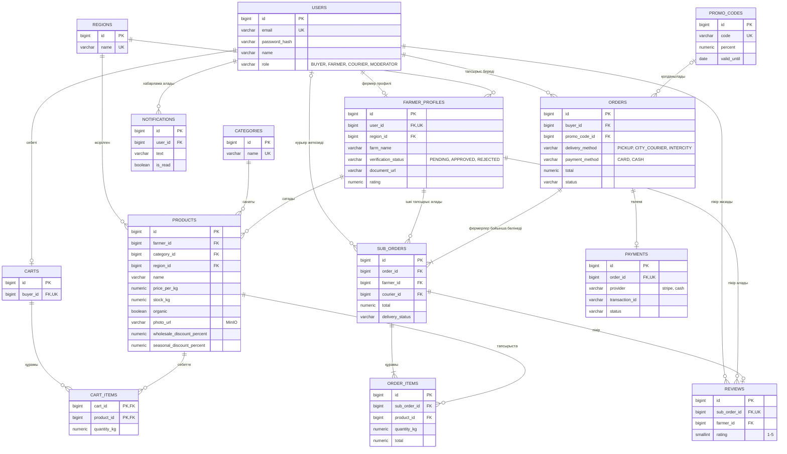

# ER-диаграмма — AgroMarket

Дерекқор: **PostgreSQL 16**. Миграциялар: **Flyway** (`backend/src/main/resources/db/migration/`).

- `V1__init.sql` — 14 кесте, байланыстар, шектеулер (constraints), индекстер
- `V2__seed_reference_data.sql` — анықтамалық деректер: өңірлер, санаттар, промокодтар

## Диаграмма

## Байланыстар

| Түрі | Байланыс | Мағынасы |
|---|---|---|
| **1 : 1** | `users` — `farmer_profiles` | Әр фермерде бір профиль (`user_id UNIQUE`) |
| **1 : 1** | `users` — `carts` | Әр сатып алушыда бір себет |
| **1 : 1** | `orders` — `payments` | Әр тапсырысқа бір төлем |
| **1 : 1** | `sub_orders` — `reviews` | Бір ішкі тапсырысқа бір пікір (US-13) |
| **1 : N** | `farmer_profiles` → `products` | Бір фермерде көп өнім |
| **1 : N** | `categories`, `regions` → `products` | Санат пен өңір бойынша сүзу (US-04) |
| **1 : N** | `users` → `orders` | Бір сатып алушыда көп тапсырыс |
| **1 : N** | `orders` → `sub_orders` | Тапсырыс фермерлер бойынша бөлінеді (US-09) |
| **M : N** | `carts` ↔ `products` | `cart_items` арқылы: себетте көп өнім, өнім көп себетте |
| **M : N** | `orders` ↔ `products` | `sub_orders` + `order_items` арқылы |

## Дерекқор деңгейіндегі тексерулер

Бизнес-ережелер кодта ғана емес, дерекқорда да қорғалған:

- `email` бірегей — бір email-мен екі рет тіркелуге болмайды (US-01)
- `REJECTED` мәртебесінде `reject_reason` міндетті (US-02)
- `price_per_kg > 0`, `stock_kg >= 0` (US-03)
- жеңілдік пайызы 0–100 аралығында (US-06, US-07)
- `rating` 1–5 аралығында (US-13)
- рөлдер, мәртебелер, жеткізу және төлем тәсілдері тек рұқсат етілген мәндерден (`CHECK ... IN (...)`)

## Seed жоспары (демо деректер)

| Деректер | Қайда жасалады | Мазмұны |
|---|---|---|
| Өңірлер, санаттар, промокодтар | `V2__seed_reference_data.sql` (Flyway) | 4 өңір, 6 санат, 3 промокод (`AGRO10`, `WELCOME5`, мерзімі өткен `OLD5`) |
| Пайдаланушылар | `DataSeeder` класы (Spring Boot, `dev` профилі) | Модератор, 2 фермер (Алматы облысы, Астана), кафе, курьер. Құпиясөздер BCrypt-пен хэштеледі, сондықтан SQL-да емес |
| Өнімдер | `DataSeeder` | Әр фермерге 3–5 өнім: қызанақ (көтерме және маусымдық жеңілдікпен), алма, картоп т.б. |

Демо сценарийі (бақылау нүктелері үшін): кафе 2 фермерден тапсырыс береді → тапсырыс 2 ішкі тапсырысқа бөлінеді → `AGRO10` промокоды мен көтерме жеңілдік қолданылады → Stripe test mode арқылы төленеді.
