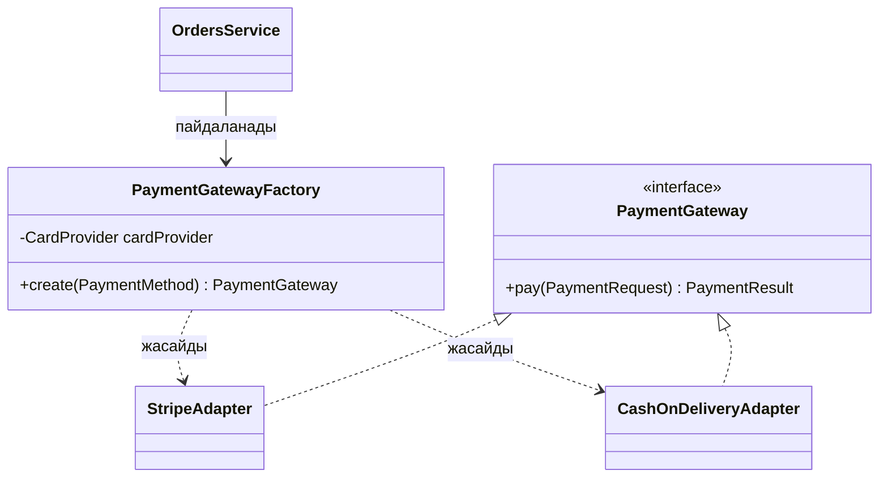
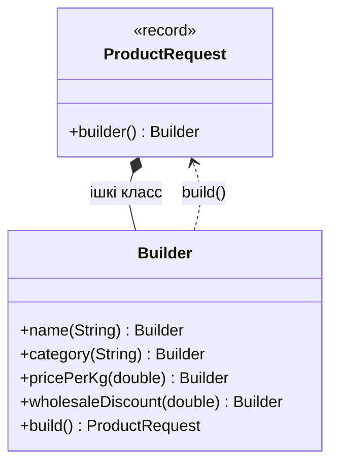
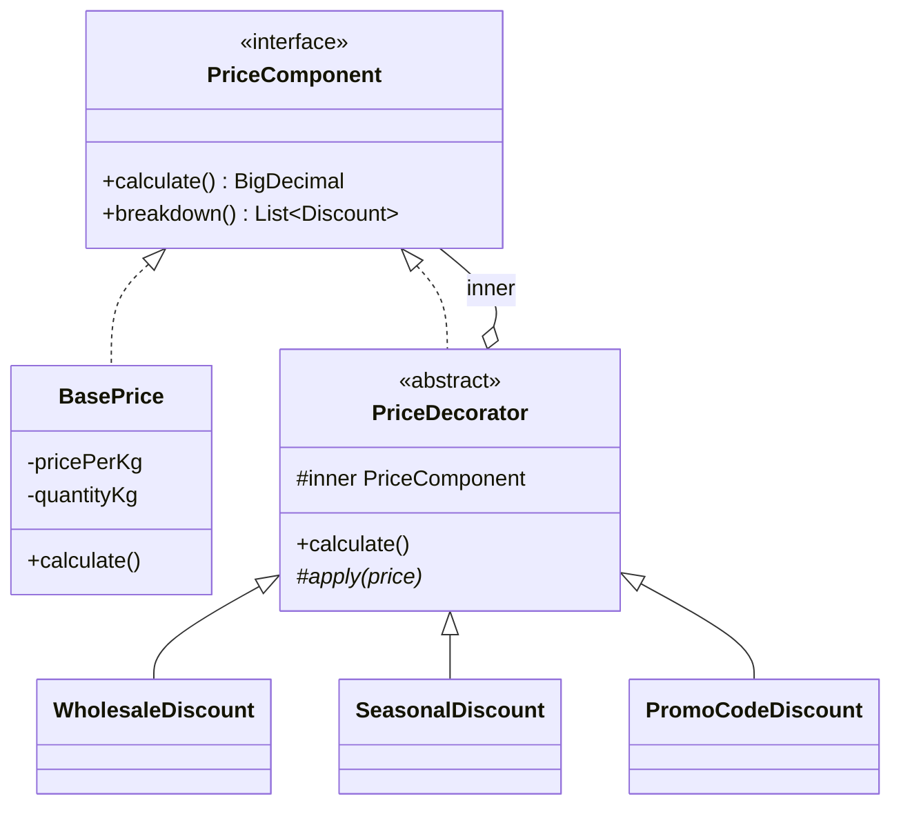
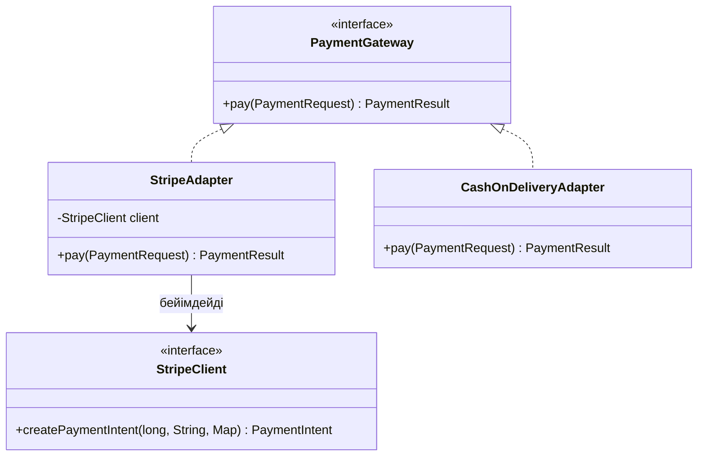
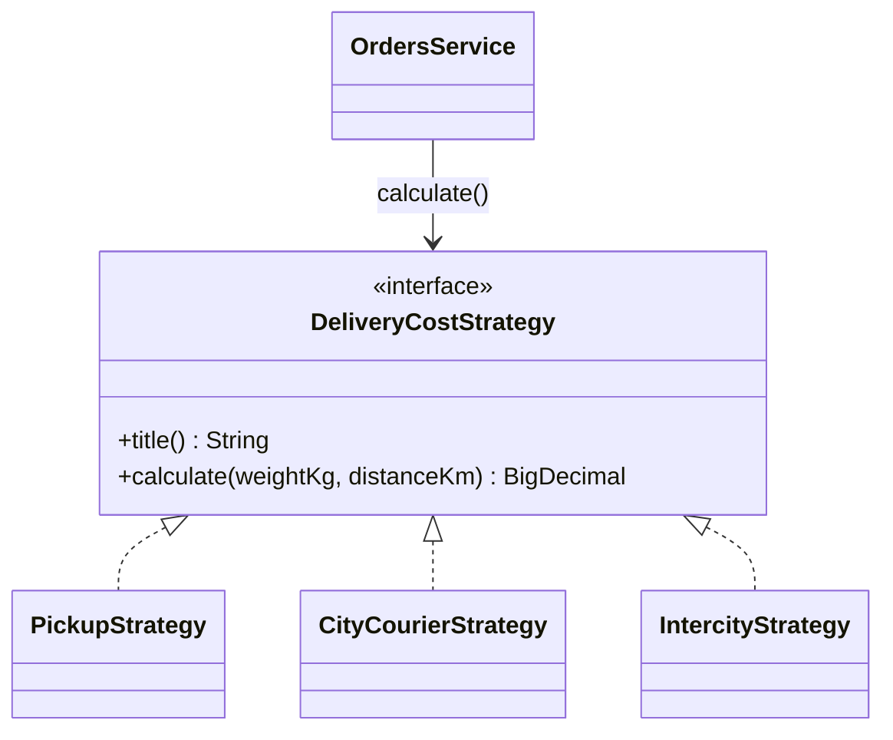
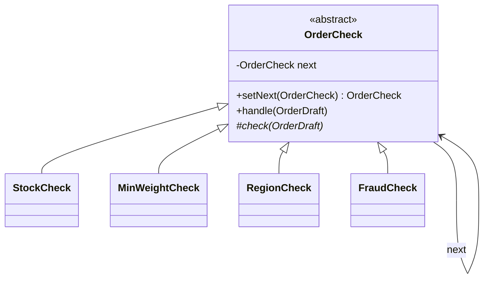
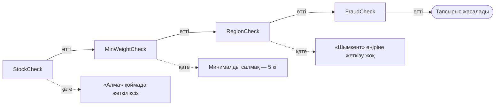
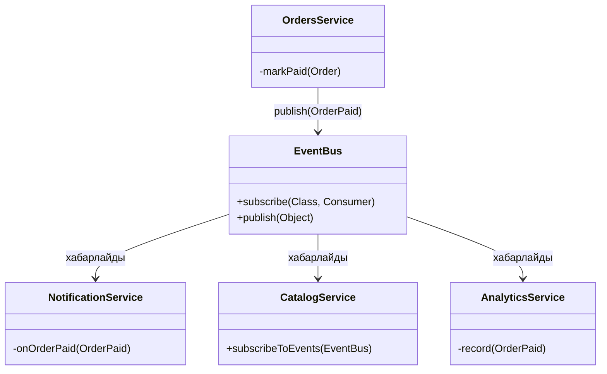
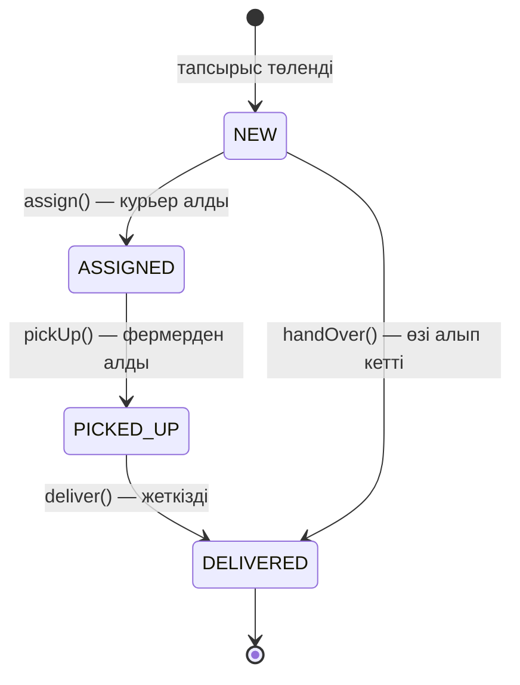

# Design Patterns — AgroMarket

Жобада **үш топтан 8 паттерн** қолданылады. Әр паттерн нақты бір мәселені шешеді және нақты user story-ге байланған.

| # | Паттерн | Тобы | Қай жерде | User story | Тест |
|---|---|---|---|---|---|
| 1 | [Factory Method](#1-factory-method) | Creational | `delivery`, `payments` | US-08, US-10 | `OrdersTest` |
| 2 | [Builder](#2-builder) | Creational | `catalog` | US-03 | `CatalogTest` |
| 3 | [Decorator](#3-decorator) | Structural | `pricing` | US-06, US-07 | `CartAndPricingTest` |
| 4 | [Adapter](#4-adapter) | Structural | `payments` | US-10 | `OrdersTest` |
| 5 | [Strategy](#5-strategy) | Behavioral | `delivery` | US-08 | `OrdersTest` |
| 6 | [Chain of Responsibility](#6-chain-of-responsibility) | Behavioral | `orders` | US-09 | `OrdersTest` |
| 7 | [Observer](#7-observer) | Behavioral | `common`, `notifications`, `analytics` | US-11, US-12 | `OrdersTest` |
| 8 | [State](#8-state) | Behavioral | `orders` (жеткізу мәртебесі) | US-14 | `DeliveryTest` |

Код: `backend/src/main/java/kz/agromarket/` · Тесттер: `backend/src/test/java/kz/agromarket/`

---

## 1. Factory Method

**Тобы:** Creational (жасаушы)

**Мәселе:** `OrdersService` жеткізу стратегиясын немесе төлем адаптерін өзі `new StripeAdapter()` арқылы жасаса, ол нақты кластарға тәуелді болады. Провайдерді ауыстыру үшін `OrdersService`-ті өзгерту керек болар еді.

**Шешім:** объект жасауды бөлек фабрикаға береміз. Сервис тек «маған карта төлемі керек» дейді, фабрика керекті класты таңдап жасайды.

**Файлдар:**
- [`delivery/DeliveryStrategyFactory.java`](../backend/src/main/java/kz/agromarket/delivery/DeliveryStrategyFactory.java)
- [`payments/PaymentGatewayFactory.java`](../backend/src/main/java/kz/agromarket/payments/PaymentGatewayFactory.java)



```java
PaymentGateway gateway = paymentFactory.create(order.getPaymentMethod());
PaymentResult result = gateway.pay(request); // қай провайдер екенін OrdersService білмейді
```

**Нәтиже:** карта провайдері `application.yml`-да ауыстырылады (`card-provider: STRIPE`), `OrdersService` өзгермейді.

---

## 2. Builder

**Тобы:** Creational (жасаушы)

**Мәселе:** өнімде 9 өріс бар. Конструкторға 9 параметрді ретімен беру қиын және қате жіберу оңай (`new ProductRequest("Қызанақ", "Көкөніс", "Алматы", 600, 500, true, photo, 10, null)` — қайсысы қай өріс?).

**Шешім:** объектіні қадамдап, әр өрісті атымен толтырамыз.

**Файл:** [`catalog/ProductRequest.java`](../backend/src/main/java/kz/agromarket/catalog/ProductRequest.java)



```java
ProductRequest request = ProductRequest.builder()
        .name("Қызанақ").category("Көкөніс").region("Алматы облысы")
        .pricePerKg(600).stockKg(500).organic(true)
        .wholesaleDiscount(10)
        .build();
```

---

## 3. Decorator

**Тобы:** Structural (құрылымдық)

**Мәселе:** бағаға бірнеше жеңілдік қолданылуы мүмкін: көтерме (50 кг-нан), маусымдық, промокод. Олар кез келген комбинацияда кездеседі. Мұрагерлікпен жасасақ, әр комбинацияға бөлек класс керек: `WholesalePrice`, `WholesaleSeasonalPrice`, `WholesaleSeasonalPromoPrice`... — класс саны тым көбейеді.

**Шешім:** әр жеңілдік — бағаны «орайтын» бөлек класс. Декораторлар бір-бірін кез келген ретте орай алады.

**Файлдар:** [`pricing/`](../backend/src/main/java/kz/agromarket/pricing/) — `PriceComponent`, `BasePrice`, `PriceDecorator`, `WholesaleDiscount`, `SeasonalDiscount`, `PromoCodeDiscount`



```java
PriceComponent price = new BasePrice(pricePerKg, 60);      // 36 000 ₸
price = new WholesaleDiscount(price, 60, 10);              // −10% → 32 400 ₸
price = new SeasonalDiscount(price, offer, today);         // −5%  → 30 780 ₸
price = new PromoCodeDiscount(price, promo);               // −10% → 27 702 ₸
```

**SOLID:** Open/Closed — жаңа жеңілдік қосу үшін бар кластар өзгермейді, бір жаңа декоратор жазылады.

---

## 4. Adapter

**Тобы:** Structural (құрылымдық)

**Мәселе:** әр төлем провайдерінің өз API-і бар. Stripe соманы тиынмен (`long`) қабылдайды және `PaymentIntent` қайтарады; қолма-қол төлемде сыртқы API мүлдем жоқ. `OrdersService` олардың әрқайсысына бейімделсе, күрделі әрі тәуелді болар еді.

**Шешім:** бір ортақ интерфейс `PaymentGateway`. Әр провайдерге адаптер жазамыз, ол провайдердің API-ін біздің интерфейске келтіреді.

**Файлдар:** [`payments/`](../backend/src/main/java/kz/agromarket/payments/) — `PaymentGateway`, `StripeAdapter`, `CashOnDeliveryAdapter`, `StripeClient`



```java
// StripeAdapter ішінде: біздің форматтан Stripe форматына
long minorUnits = request.amount().multiply(BigDecimal.valueOf(100)).longValueExact();
PaymentIntent intent = client.createPaymentIntent(minorUnits, "kzt", Map.of("orderId", id));
return new PaymentResult(success, Status.PAID, intent.id(), "stripe", null);
```

**SOLID:** Liskov Substitution — кез келген адаптер бірдей `PaymentResult` қайтарады, сондықтан Stripe-ты қолма-қол төлемге ауыстыру тапсырысты бұзбайды.

---

## 5. Strategy

**Тобы:** Behavioral (мінез-құлықтық)

**Мәселе:** жеткізу құны тәсілге қарай әртүрлі формуламен есептеледі: өзі алып кету — тегін, қала ішінде — тұрақты баға, қалааралық — салмақ пен қашықтық бойынша. `if/else` тізбегімен жазсақ, әр жаңа тәсіл бар кодты өзгертеді.

**Шешім:** әр формула — бөлек стратегия класы. Қажетті стратегия жұмыс кезінде таңдалады.

**Файлдар:** [`delivery/`](../backend/src/main/java/kz/agromarket/delivery/) — `DeliveryCostStrategy`, `PickupStrategy`, `CityCourierStrategy`, `IntercityStrategy`



| Стратегия | Формула |
|---|---|
| `PickupStrategy` | 0 ₸ |
| `CityCourierStrategy` | 1 500 ₸ |
| `IntercityStrategy` | 2 000 + салмақ × 30 + қашықтық × 15 |

---

## 6. Chain of Responsibility

**Тобы:** Behavioral (мінез-құлықтық)

**Мәселе:** тапсырыс жасалмас бұрын бірнеше тәуелсіз тексеру керек: қойма, минималды салмақ, өңір, күдікті тапсырыс. Бәрін `OrdersService` ішіне жазсақ, ол үлкейеді және тексеруді қосу/алып тастау қиын болады.

**Шешім:** әр тексеру — тізбектің бір буыны. Буын тексереді: қате болса — тізбекті тоқтатып, түсінікті қате береді; бәрі дұрыс болса — келесі буынға береді.

**Файлдар:** [`orders/OrderCheck.java`](../backend/src/main/java/kz/agromarket/orders/OrderCheck.java), [`orders/OrderChecks.java`](../backend/src/main/java/kz/agromarket/orders/OrderChecks.java)





```java
OrderCheck first = new StockCheck();
first.setNext(new MinWeightCheck(5))
     .setNext(new RegionCheck(supportedRegions))
     .setNext(new FraudCheck(2000));
```

**SOLID:** Open/Closed — жаңа тексеру = жаңа класс + `setNext()`, `OrdersService` өзгермейді.

---

## 7. Observer

**Тобы:** Behavioral (мінез-құлықтық)

**Мәселе:** төлемнен кейін 3 тәуелсіз әрекет орындалуы керек: фермерге хабарлама, қалдықты азайту, статистиканы жаңарту. `OrdersService` оларды тікелей шақырса, ол `notifications`, `catalog`, `analytics` модульдеріне тәуелді болады.

**Шешім:** `OrdersService` тек `OrderPaid` оқиғасын жариялайды. Қызығатын модульдер оған алдын ала жазылады (subscribe) және өздері өңдейді.

**Файлдар:** [`common/EventBus.java`](../backend/src/main/java/kz/agromarket/common/EventBus.java), [`notifications/NotificationService.java`](../backend/src/main/java/kz/agromarket/notifications/NotificationService.java), [`analytics/AnalyticsService.java`](../backend/src/main/java/kz/agromarket/analytics/AnalyticsService.java)



**Келесі қадам:** `EventBus` Spring-тің `ApplicationEventPublisher` және `@EventListener` механизмімен ауыстырылады — паттерн сол қалады.

---

## 8. State

**Тобы:** Behavioral (мінез-құлықтық) · **User story:** US-14

**Мәселе:** жеткізу мәртебесі тек белгілі ретпен ауысуы керек: `NEW → ASSIGNED → PICKED_UP → DELIVERED`. Курьер алмаған тапсырысты «жеткізілді» деуге немесе жеткізілгенін қайта алуға болмайды. `if (status == ... && action == ...)` тексерулері сервистің бәріне тарап кетер еді.

**Шешім:** әр мәртебе өзі қай мәртебеге ауыса алатынын біледі. Java-да мұны `enum` арқылы жазамыз: әр мән тек өзіне рұқсат етілген әдісті қайта анықтайды, қалғандары 409 қатесін береді.

**Файлдар:** [`orders/DeliveryStatus.java`](../backend/src/main/java/kz/agromarket/orders/DeliveryStatus.java), `SubOrderEntity.assignTo / pickUp / deliver / handOver`, `DeliveryService`



| Мәртебе | Рұқсат етілген әрекет | Қалғандары |
|---|---|---|
| `NEW` | `assign()`, `handOver()` | 409 |
| `ASSIGNED` | `pickUp()` | 409 |
| `PICKED_UP` | `deliver()` | 409 |
| `DELIVERED` | — (соңғы күй) | 409 |

Әр ауысудан кейін `DeliveryStatusChangedEvent` жарияланады — сатып алушыға хабарламаны Observer тыңдаушысы жібереді.

---

## SOLID принциптері

| Принцип | Жобадағы мысал |
|---|---|
| **S** — Single Responsibility | `CartService` тек себетті басқарады; бағаны `PricingService`, жеткізуді стратегиялар есептейді |
| **O** — Open/Closed | Жаңа жеңілдік — жаңа декоратор; жаңа тексеру — тізбектің жаңа буыны; жаңа жеткізу — жаңа стратегия |
| **L** — Liskov Substitution | `StripeAdapter` пен `CashOnDeliveryAdapter` бірін-бірі алмастыра алады: екеуі де `PaymentResult` қайтарады |
| **I** — Interface Segregation | `PriceComponent`, `DeliveryCostStrategy`, `PaymentGateway` — әрқайсысында тек 1–2 әдіс |
| **D** — Dependency Inversion | `OrdersService` нақты кластарға емес, интерфейстер мен фабрикаларға тәуелді; тәуелділіктерді Spring DI береді (`config/DomainConfig.java`) |
